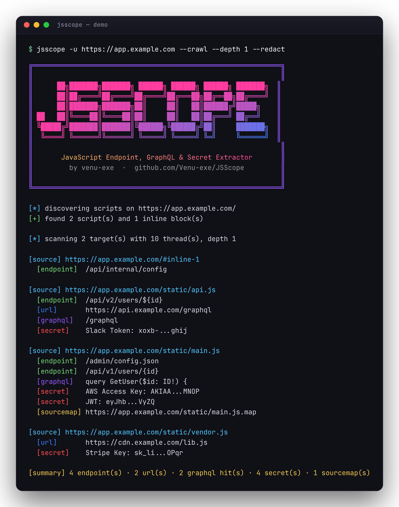

<div align="center">
  <h1>🔍 JSScope</h1>
  <p><b>JavaScript endpoint, GraphQL, and secret extractor for bug bounty recon.</b></p>

  <p>
    <a href="https://github.com/Venu-exe/JSScope/stargazers"></a>
    <a href="https://github.com/Venu-exe/JSScope/network/members"></a>
    <a href="https://github.com/Venu-exe/JSScope/actions/workflows/tests.yml"></a>
    <a href="https://github.com/Venu-exe/JSScope/blob/master/LICENSE"></a>
  </p>

  <p>
    <b>⭐️ If JSScope saves you time during recon, leave a star and tell me what to improve! ⭐️</b>
  </p>
</div>

---

Point JSScope at a `.js` file, an HTML page (with `--crawl`), a local file, or a
list of URLs. It pulls out:

- **Endpoints / routes** — `/api/v1/users/{id}`, `/admin/config.json`, template-literal paths
- **Absolute URLs** embedded in scripts
- **GraphQL operations** — `query`, `mutation`, `subscription`, `/graphql` paths, `gql` tags
- **Leaked secrets** — AWS, Google, GitHub, Slack, Stripe, SendGrid, Twilio, Mailgun, JWTs, private key blocks, Firebase URLs, basic-auth URLs, generic API keys
- **Source map references** — resolved to absolute URLs so you can fetch the original code

Scans run in parallel, and `--depth` follows relative `import` / `require` /
`importScripts` chains so lazy-loaded bundles don't get missed.

<p align="center">
  
</p>

## Install

Requires Python 3.9+.

```bash
git clone https://github.com/Venu-exe/JSScope.git
cd JSScope
pip install -r requirements.txt
```

Or install it as a command with [pipx](https://pipx.pypa.io/):

```bash
pipx install .
jsscope --help
```

## Usage

### The basics

Scan a single JS file:

```bash
python3 jsscope.py -u https://target.com/static/js/main.js
```

Crawl a page, discover its scripts, and follow one level of imports:

```bash
python3 jsscope.py -u https://target.com --crawl --depth 1
```

Scan a list of URLs and save structured results:

```bash
python3 jsscope.py -l urls.txt -o results.json
```

Read URLs from stdin (great for piping from other recon tools):

```bash
cat urls.txt | python3 jsscope.py -l - --redact
```

Scan a local or de-minified bundle:

```bash
python3 jsscope.py -f ./bundle.js
```

Filter noise and only keep API routes:

```bash
python3 jsscope.py -u https://target.com/main.js --filter '/api/' --exclude '\.(svg|png)$'
```

### Authenticated scans

Send cookies and bearer tokens with repeatable `-H` flags:

```bash
python3 jsscope.py -u https://app.target.com --crawl --depth 2 \
  -H 'Cookie: session=abc123; csrf=xyz' \
  -H 'Authorization: Bearer eyJhbGciOi...'
```

Authenticated scans usually surface the interesting stuff — private API
routes often only appear in the JS served to logged-in users.

### Route traffic through Burp or Caido

```bash
python3 jsscope.py -u https://target.com --crawl --depth 2 \
  --proxy http://127.0.0.1:8080
```

TLS verification is off by default, so Burp's MITM certificate works without
extra setup. Use `--verify` when you want strict certificate checks.

### Follow lazy-loaded chunks

Modern SPAs split routes into dynamically imported chunks. Raise `--depth` to
walk the import graph:

```bash
# main.js -> ./chunks/*.js -> further nested imports
python3 jsscope.py -u https://target.com/static/main.js --depth 3
```

Imports that point to another origin are skipped, so you stay on the target.

### Be gentle on rate-limited targets

```bash
python3 jsscope.py -l urls.txt -t 3 --delay 0.5 --timeout 20
```

`--delay` sleeps between every request; `-t` caps concurrent workers.

### Recon pipelines

Feed URLs from subdomain and crawl tooling straight into JSScope:

```bash
# subfinder -> httpx -> katana -> JSScope
subfinder -d target.com -silent \
  | httpx -silent -mc 200 \
  | katana -silent -jc -d 2 \
  | grep -Ei '\.js(\?|$)' \
  | python3 jsscope.py -l - -o crawl.json --no-banner
```

Or harvest archived JS files with `gau` / `waybackurls`:

```bash
gau target.com | grep -Ei '\.js(\?|$)' \
  | python3 jsscope.py -l - -o archive.json --no-banner
```

Any tool that prints one URL per line works with `-l -`.

### High-signal endpoint hunting

Only keep admin, internal, debug, versioned API, and GraphQL routes:

```bash
python3 jsscope.py -l urls.txt -o results.json \
  --filter '/(admin|internal|private|debug|actuator|graphql|api/v[0-9]+)/' \
  --exclude '^/(static|assets|images)/'
```

Pull just the unique paths afterwards:

```bash
jq -r '.[].endpoints[]' results.json | sort -u
```

### GraphQL surface discovery

Collect every GraphQL hint (paths, operations, `gql` tags) across a target:

```bash
python3 jsscope.py -u https://app.target.com --crawl --depth 2 \
  --filter 'graphql|query|mutation|subscription' --no-secrets
```

### Recover original source from source maps

JSScope resolves `sourceMappingURL` references to absolute URLs. Download them
in bulk:

```bash
jq -r '.[].sourcemaps[]' results.json | sort -u > maps.txt
while read -r map; do
  curl -sSL "$map" -o "$(basename "${map%%\?*}")"
done < maps.txt
```

Then unpack a map with
[unwebpack-sourcemap](https://github.com/rarecoil/unwebpack-sourcemap) to get
readable source files:

```bash
unwebpack-sourcemap.py -o recovered ./main.js.map
```

### Secret triage

List findings as TSV with the file they came from, then verify manually:

```bash
jq -r '.[] | .source as $s | .secrets[] | [.type, .match, $s] | @tsv' results.json
```

Found something you want to share? Add `--redact` so values are masked in the
console:

```bash
python3 jsscope.py -u https://target.com/main.js --redact
```

Use `--no-secrets` when you only care about endpoints and GraphQL.

### Track changes between runs

Save a baseline, rescan later, and diff the endpoint sets:

```bash
# baseline run
python3 jsscope.py -u https://target.com --crawl --depth 2 -o baseline.json --no-banner
jq -r '.[].endpoints[]' baseline.json | sort -u > baseline.txt

# later, after the target ships a new build
python3 jsscope.py -u https://target.com --crawl --depth 2 -o today.json --no-banner
jq -r '.[].endpoints[]' today.json | sort -u > today.txt

comm -13 baseline.txt today.txt   # endpoints that appeared
```

### Use it as a library

The extraction logic is importable if you already have the JS in memory:

```python
from jsscope import extract

findings = extract(open("bundle.js", encoding="utf-8").read(), "bundle.js")
print(findings["endpoints"])
print(findings["secrets"])
```

## Options

| Flag | Description |
|---|---|
| `-u, --url` | single URL (`.js` file, or a page with `--crawl`) |
| `-l, --list` | file of URLs, one per line (`#` comments, `-` for stdin) |
| `-f, --file` | scan a local file instead of fetching a URL |
| `--crawl` | treat `-u` as HTML and discover linked + inline scripts |
| `--depth N` | follow relative JS imports `N` levels deep (default: `0`) |
| `-o, --output` | write structured JSON results to this path |
| `-t, --threads` | concurrent fetches (default: `10`) |
| `--timeout` | request timeout in seconds (default: `12`) |
| `--delay SEC` | sleep between requests for rate-limited targets |
| `-H, --header` | extra request header, e.g. `-H 'Cookie: session=...'` (repeatable) |
| `--proxy` | send traffic through a proxy, e.g. Burp at `http://127.0.0.1:8080` |
| `--verify` | enforce TLS verification (off by default for self-signed targets) |
| `--filter REGEX` | only keep endpoints/URLs/GraphQL matching `REGEX` |
| `--exclude REGEX` | drop endpoints/URLs/GraphQL matching `REGEX` |
| `--redact` | mask secret values in console output (safe for screenshots) |
| `--no-secrets` | hide secret findings |
| `--no-banner` | skip the startup banner |
| `--no-color` | disable ANSI colors (also honors `NO_COLOR`) |
| `--version` | print the version and exit |

## Output

The console groups findings per source file and ends with a summary line. Use
`-o results.json` to also save the full structured data:

```json
[
  {
    "source": "https://target.com/main.js",
    "endpoints": ["/api/v1/users/{id}", "/admin/config.json"],
    "urls": ["https://api.target.com/graphql"],
    "graphql": ["/graphql", "query GetUser($id: ID!) {"],
    "secrets": [{"type": "JWT", "match": "eyJhbGciOi..."}],
    "sourcemaps": ["https://target.com/static/main.js.map"]
  }
]
```

Every result object has the same keys, so `jq` works cleanly:

```bash
jq -r '.[].endpoints[]' results.json | sort -u
jq -r '.[] | select(.secrets | length > 0) | .source' results.json
```

## How it works

1. **Fetch** — threaded HTTP client with retries, optional proxy/custom headers,
   and rate limiting.
2. **Discover** — with `--crawl`, parse `<script src>`, inline `<script>` bodies,
   and `<link rel="modulepreload">` / `preload as="script">` tags. With
   `--depth`, queue relative imports found inside each script.
3. **Extract** — regex signatures for paths, absolute URLs, GraphQL operations,
   source maps, and known secret formats.
4. **Filter & report** — deduplicate, apply `--filter` / `--exclude`, redact if
   requested, and emit console + optional JSON output.

## Detection notes

- Secret detection is signature-based (plus a Shannon-entropy check and a
  placeholder blocklist for generic keys). It will still produce false
  positives and false negatives. **Verify before reporting.**
- Endpoint regexes match quoted strings, including template literals, so
  interpolated paths show up as `/api/users/${id}`.
- TLS verification is off by default because bug bounty targets often use
  self-signed or expired certificates. Add `--verify` to turn it back on.

## Development

```bash
pip install -r requirements.txt pytest
pytest -q
```

Tests cover endpoint/URL/GraphQL extraction, secret handling, source maps,
import discovery, HTML crawling, filters, and redaction. CI runs them on every
push against Python 3.9, 3.11, and 3.13.

## Contributing

Bug reports, feature requests, and feedback are welcome in the
[Issues tab](https://github.com/Venu-exe/JSScope/issues/new/choose). If you send
a PR, keep changes consistent with the existing single-file structure and add a
test for new extraction behavior.

## ⚠️ Disclaimer

Only use JSScope against targets you are authorized to test — programs you're
enrolled in on a bug bounty platform, or assets you own. Scanning systems
without permission may be illegal in your jurisdiction. You are responsible for
how you use this tool.

## License

[MIT](LICENSE)
